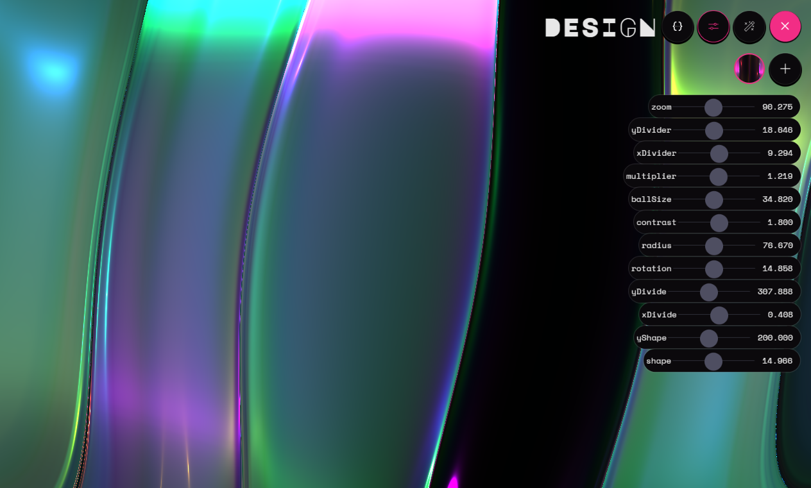

# Visualify

**A music visualizer for Windows and the web that reacts to whatever is playing: the Spotify app, a browser tab, a game, anything.**

**[Open it in your browser](https://assafhaft.github.io/visualify/)**, or get the Windows app from [Releases](https://github.com/AssafHaft/visualify/releases).

Visualify listens to your audio in real time and drives 50 hand-made WebGL shader designs with it. It shows what Spotify is playing, with play/pause/skip controls, and can shuffle between designs in time with the music. There's no login, no API key and no Spotify developer account.

> **Built on [Kaleidosync](https://github.com/zachwinter/kaleidosync) by [Zach Winter](https://github.com/zachwinter).**
> The visuals, the shader designs, the realtime audio analysis and most of the UI are his work, from the Kaleidosync
> repository and his `@wearesage/*` packages. Visualify wraps that work in a desktop app and a web version, and adds system-audio capture,
> Spotify now-playing, design shuffle, and saved customizations. Please star and support [the original project](https://github.com/zachwinter/kaleidosync) and [kaleidosync.com](https://www.kaleidosync.com).


## Features

- **Reacts to all system audio.** Visualify captures what your speakers play (WASAPI loopback), so it works with the Spotify desktop app or any other player. It starts on launch with no setup.
- **Spotify now playing.** Shows the current track with previous / play-pause / next controls, through Windows' built-in media controls. If Spotify isn't running, it follows whichever app is playing.
- **50 shader designs.** Browse them, switch with the arrow keys, or go fullscreen on a second monitor.
- **Shuffle.** Dissolves from one design to the next at random intervals, timed to lifts in the music (a chorus, a drop, a new song), so changes land with the song.
- **Customize and save.** Tweak any design's parameters with sliders, save your favourite looks with **+**, and delete them again. They're kept across restarts.
- **Settings that stick.** Menu labels, always-visible track info and shuffle are all saved.



## Web version

Open **[assafhaft.github.io/visualify](https://assafhaft.github.io/visualify/)**, tap **Get started**, and choose what it listens to:

| Where | What it can hear |
| --- | --- |
| Chrome or Edge on a computer | **System Audio**: the whole computer on Windows (pick **Entire screen** and turn on **Share system audio**), or any tab (turn on **Share tab audio**, e.g. for the [Spotify web player](https://open.spotify.com)). Or **Microphone**. |
| Firefox, Safari, phones and tablets | **Microphone**: play the music out loud and it reacts to what it hears. |

Browsers don't let a web page hear other apps directly. System Audio goes through the screen-sharing prompt (only the audio is used), and phones don't offer screen sharing to web pages at all, so on a phone the microphone is the way in. The screen stays awake while it runs.

Compared with the desktop app, the web version has no Spotify track info or controls (browsers can't read them), and Back leaves the app rather than going to the previous page.

## Requirements

- **Web version:** a current browser. Nothing to install.
- **Windows app:** Windows 10 (version 1809 or later) or Windows 11
- [Node.js](https://nodejs.org) 22 or later, to build either one
- Spotify (optional), or any other audio

## Getting started

```bash
git clone https://github.com/AssafHaft/visualify.git
cd visualify
npm install
npm run package
```

This builds `release/Visualify-win32-x64/Visualify.exe`. The whole folder is the app and needs nothing else installed. To keep it handy, open it and right-click its taskbar icon → **Pin to taskbar**.

To run it straight from the source instead:

```bash
npm run desktop
```

## Using it

Play music like you normally would. The visuals react on their own.

| Action | How |
| --- | --- |
| Show the menu | Move the mouse (it hides after 2 seconds) |
| Previous / next design | Arrow keys |
| Browse all designs | **Designs** |
| Tweak the current design | **Customize** |
| Fullscreen | **Fullscreen** button or <kbd>F11</kbd> (<kbd>Esc</kbd> / <kbd>F11</kbd> to exit) |
| Play / pause / skip | Buttons next to the track name, bottom left |

### Customizing designs

On the **Customize** page:

- The sliders change the current design.
- **+** saves the current look as a new variant of that design. It lights up once you've changed something.
- The trash icon deletes the selected variant, after confirming. A design's first variant is its original look and can't be deleted.
- The circles are your saved variants; click one to switch to it.
- The wand randomizes the look, and `{}` opens the shader code editor (code edits aren't saved).

### Settings

| Setting | What it does |
| --- | --- |
| Show Menu Labels | Text labels on the menu buttons |
| Always Show Track | Keeps the track name and controls on screen when the menu hides |
| Shuffle Designs | Moves between designs automatically, with the music (on by default) |

## How it works

| Part | File |
| --- | --- |
| Electron shell. Serves the built app over a private `app://` scheme and grants system-audio capture | [`desktop.js`](desktop.js) |
| What the visualizer hears: Windows system audio (desktop), or the screen-share prompt or microphone (web) | [`src/platform.ts`](src/platform.ts) |
| Reads the current track and sends play/pause/skip through Windows' media session API | [`media.ps1`](media.ps1) |
| Track display and controls | [`src/components/NowPlaying.vue`](src/components/NowPlaying.vue) |
| When shuffle moves on (a random wait, then a lift in loudness) | [`src/shuffle.ts`](src/shuffle.ts) |
| Rendering, the shuffle dissolve, loading saved variants | [`src/components/Renderer.vue`](src/components/Renderer.vue) |
| Saved settings and variants | [`src/settings.ts`](src/settings.ts) |
| Builds the web version and publishes it to GitHub Pages on every push | [`.github/workflows/pages.yml`](.github/workflows/pages.yml) |

Audio is analysed on your device and never uploaded. The only network requests are for the app itself and its web fonts.

## Development

| Command | What it does |
| --- | --- |
| `npm run dev` | Run the web version at http://localhost:5173 |
| `npm run desktop` | Build and run the Windows app |
| `npm run package` | Build the Windows app into `release/` |
| `npm run check` | Build, then smoke-test the running app. Play something first: it checks shuffle timing, that system audio drives the visuals, that now playing shows the track, and that the visuals don't freeze when a design's settings change |

## Known limitations

- The desktop app is Windows only, because its system-audio capture and media controls are Windows features.
- It hears all system audio, so notification sounds make it pulse too.
- Track info and controls can lag by up to about a second. There's no album art.
- A single design can hold about 60 saved variants in the desktop app, and about 15 in a browser.
- Shader code edits aren't saved.
- Kaleidosync's own Spotify web login isn't available. It relies on Spotify's audio-analysis API, which Spotify closed to new apps in November 2024. Visualify listens to the actual audio instead.

## Credits

- **[Kaleidosync](https://github.com/zachwinter/kaleidosync)** by **[Zach Winter](https://github.com/zachwinter)**: the visualizer this project is built on, including its shader designs, realtime audio analysis, and UI (via the `@wearesage/*` packages).
- [Electron](https://www.electronjs.org), [Vue](https://vuejs.org), [Three.js](https://threejs.org) and [TresJS](https://tresjs.org).

## License

The original Kaleidosync repository doesn't include a license, so its code remains the property of its author, and this repository grants no rights to it. If you want to redistribute or reuse it, please contact [Zach Winter](https://github.com/zachwinter) first.
